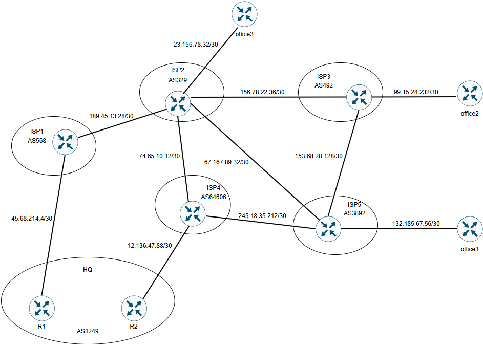
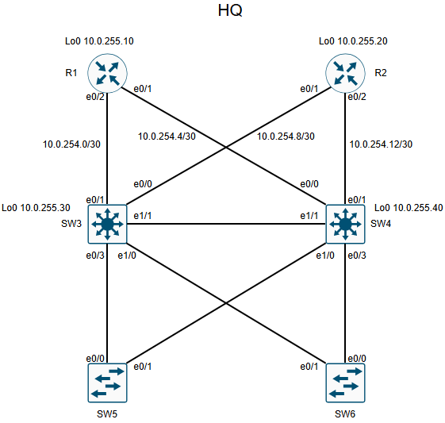

# Организация сети в центральном офисе и филиалах.

## Цель проектной работы организовать выход в интернет в главном офисе и филиалах, а так же связать офис и филиалы между собой.

### План работ:

1. Разработать и задокументировать адресное пространство для лабораторного стенда.
2. Настроить локальную сеть в офисе HQ. Протокол маршрутизации OSPF, HSRP, DHCP, RSTP, VLAN.
3. Настроить NAT в офисе HQ и филиалах.
4. Настроить связность между провайдерами и офисом HQ по протоколу BGP.
5. Настроить связность между офисом HQ и филиалами. (DMVPN, IPSEC, IBGP).

#### Схема

#### Префиксы по регионам:
| Регион | ipv4 |
|-------|------|
|HQ |10.0.0.0/16|
|office1|172.20.0.0/16|
|office2|172.31.0.0/16|
|office3|192.168.0.0/16|

### IP адреса соединений между регионами:
| Equip | ipv4 | 
|-------|------|
| HQ(R1) - ISP1| 45.68.214.4/30|
| HQ(R2) - ISP4 | 12.136.47.88/30|
| ISP1 - ISP2 | 189.45.13.28/30|
| ISP2 - ISP3 | 156.78.22.36/30|
| ISP2 - ISP4 | 74.65.10.12/30|
| ISP2 - ISP5 | 67.167.89.32/30|
| ISP2 - office3 | 23.156.78.32/30|
| ISP3 - ISP5 | 153.68.28.128/30|
| ISP3 - office2 | 99.15.28.232/30|
| ISP4 - ISP5 | 245.18.35.212/30|
| ISP5 - office1 | 132.185.67.56/30|

### ISP1 AS568

| Equip | Port | Address                  | Network                | Description   |
|-------|------|--------------------------|------------------------|---------------|
|  ISP1  | e0/0 | 45.68.214.6/30          |45.68.214.4/30          | ISP1 to HQ(R1)|
|  ISP1  | e0/1 | 189.45.13.30/30         |189.45.13.28/30         | ISP1 to ISP2  |

### ISP2 AS329

| Equip | Port | Address                  | Network                | Description    |
|-------|------|--------------------------|------------------------|----------------|
| ISP2  | e0/0 | 189.45.13.29/30          |189.45.13.28/30         | ISP2 to ISP1   |
| ISP2  | e0/1 | 67.167.89.33/30          |67.167.89.32/30         | ISP2 to ISP5   |
| ISP2  | e0/2 | 156.78.22.37/30          |156.78.22.36/30         | ISP2 to ISP3   |
| ISP2  | e0/3 | 74.65.10.14/30           |74.65.10.12/30          | ISP2 to ISP4   |
| ISP2  | e1/0 | 23.156.78.33/30          |23.156.78.32/30         | ISP2 to office3|

### ISP3 AS492

| Equip | Port | Address                  | Network                | Description    |
|-------|------|--------------------------|------------------------|----------------|
| ISP3  | e0/0 | 156.78.22.38/30          |156.78.22.36/30         | ISP3 to ISP2   |
| ISP3  | e0/1 | 153.68.28.130/30         |153.68.28.128/30        | ISP3 to ISP5   |
| ISP3  | e0/2 | 99.15.28.233/30          |99.15.28.232/30         | ISP3 to office2|

### ISP4 AS64606

| Equip | Port | Address                  | Network                | Description    |
|-------|------|--------------------------|------------------------|----------------|
| ISP4  | e0/0 | 12.136.47.89/30          |12.136.47.88/30         | ISP4 to HQ(R2) |
| ISP4  | e0/1 | 245.18.35.213/30         |245.18.35.212/30        | ISP4 to ISP5   |
| ISP4  | e0/2 | 74.65.10.13/30           |74.65.10.12/30          | ISP4 to ISP2   | 

### ISP5 AS3892

| Equip | Port | Address                  | Network                | Description    |
|-------|------|--------------------------|------------------------|----------------|
| ISP5  | e0/0 | 245.18.35.214/30         |245.18.35.212/30        | ISP5 to ISP4   |
| ISP5  | e0/1 | 67.167.89.34/30          |67.167.89.32/30         | ISP5 to ISP2   |
| ISP5  | e0/2 | 132.185.67.57/30         |132.185.67.56/30        | ISP2 to office1|
| ISP5  | e0/3 | 153.68.28.129/30         |153.68.28.128/30        | ISP5 to ISP3   |

### HQ AS1249

| Equip | Port | Address                  | Network                | Description   |
|-------|------|--------------------------|------------------------|---------------|
|  R1   | e0/0        | 45.68.214.5/30          |45.68.214.4/30         | R1 to ISP1    |
|  R1   | e0/1        | 10.0.254.5/30           |10.0.254.4/30          | R1 to SW4     |
|  R1   | e0/2        | 10.0.254.1/30           |10.0.254.0/30          | R1 to SW3     |
|  R1   | Lo0         | 10.0.255.10/32          |                       | Loopback      |
|  R2   | e0/0        | 12.136.47.90/30         |12.136.47.88/30        | R2 to ISP4    |
|  R2   | e0/1        | 10.0.254.9/30           |10.0.254.8/30          | R2 to SW3     |
|  R2   | e0/2        | 10.0.254.13/30          |10.0.254.12/30         | R2 to SW4     |
|  R2   | Lo0         | 10.0.255.20/32          |                       | Loopback      |
|  SW3  | e0/0        | 10.0.254.10/30          |10.0.254.8/30          | SW3 to R2     |
|  SW3  | e0/1        | 10.0.254.2/30           |10.0.254.0/30          | SW3 to R1     |
|  SW3  | int Vl30    | 10.0.30.1/24            |10.0.30.0/24           | int vlan 30   |
|  SW3  | Lo0         | 10.0.255.30/32          |                       | Loopback      |
|  SW4  | e0/0        | 10.0.254.6/30           |10.0.254.4/30          | SW4 to R1     |
|  SW4  | e0/1        | 10.0.254.14/30          |10.0.254.12/30         | SW4 to R2     |
|  SW4  | int Vl40    | 10.0.40.1/24            |10.0.40.0/24           | int Vlan 40   |
|  SW4  | Lo0         | 10.0.255.40/32          |                       | Loopback      |
|  SW5  | mgmt ip     | 10.0.30.254/24          |10.0.30.0/24           | Management    |
|  SW6  | mgmt ip     | 10.0.40.254/24          |10.0.40.0/24           | Management    |

Схема HQ.

### Office1

| Equip | Port | Address                  | Network                | Description    |
|-------|------|--------------------------|------------------------|----------------|
|Office1| e0/0 | 132.185.67.58/30         |132.185.67.56/30        |Office1 to ISP5 |
|Office1| e0/1 | 172.20.10.1/2            |172.20.10.0/24          | Gateway        |
|Office1| lo0  | 172.20.255.10            |                        | Loopback       |
|Office1| LAN  |                          |172.20.10.0/24          | LAN            |

### Office2

| Equip | Port | Address                  | Network                | Description    |
|-------|------|--------------------------|------------------------|----------------|
|Office2| e0/0 | 99.15.28.234/30          |99.15.28.232/30         |Office2 to ISP3 |
|Office2| e0/1 | 172.31.20.1/24           |172.31.20.0/24          | Gateway        |
|Office2| lo0  | 172.31.255.20            |                        | Loopback       |
|Office2| LAN  |                          |172.31.20.0/24          | LAN            |
### Office3

| Equip | Port | Address                  | Network                | Description    |
|-------|------|--------------------------|------------------------|----------------|
|Office3| e0/0 | 23.156.78.34/30          |23.156.78.32/30         |Office3 to ISP2 |
|Office3| lo0  | 192.168.30.1/24          |192.168.30.0/24         | Gateway        |
|Office3| lo0  | 192.168.255.30           |                        | Loopback       |
|Office3| lo0  |                          |192.168.30.0/24         | LAN            |

### Настроим L2 сегмент в офисе HQ.(HSRP,RSTP,Vlan)
~~~
SW3#
spanning-tree mode rapid-pvst
spanning-tree extend system-id
spanning-tree vlan 1,30 priority 4096
spanning-tree vlan 40 priority 16384
!
interface Ethernet0/3
 switchport trunk encapsulation dot1q
 switchport mode trunk
!
interface Ethernet1/0
 switchport trunk encapsulation dot1q
 switchport mode trunk
!
interface Ethernet1/1
 switchport trunk encapsulation dot1q
 switchport mode trunk
!
interface Vlan30
 ip address 10.0.30.2 255.255.255.0
 standby 30 ip 10.0.30.1
 standby 30 priority 150
 standby 30 preempt
!
interface Vlan40
 ip address 10.0.40.2 255.255.255.0
 standby 40 ip 10.0.40.1
 standby 40 priority 110
 standby 40 preempt
~~~
~~~
SW4#
spanning-tree mode rapid-pvst
spanning-tree extend system-id
spanning-tree vlan 1,30 priority 16384
spanning-tree vlan 40 priority 4096
!
interface Ethernet0/3
 switchport trunk encapsulation dot1q
 switchport mode trunk
!
interface Ethernet1/0
 switchport trunk encapsulation dot1q
 switchport mode trunk
!
interface Ethernet1/1
 switchport trunk encapsulation dot1q
 switchport mode trunk
!
interface Vlan30
 ip address 10.0.30.3 255.255.255.0
 standby 30 ip 10.0.30.1
 standby 30 priority 110
 standby 30 preempt
!
interface Vlan40
 ip address 10.0.40.3 255.255.255.0
 standby 40 ip 10.0.40.1
 standby 40 priority 150
 standby 40 preempt
~~~
~~~
SW3#sh standby brief
                     P indicates configured to preempt.
                     |
Interface   Grp  Pri P State   Active          Standby         Virtual IP
Vl30        30   150 P Active  local           10.0.30.3       10.0.30.1
Vl40        40   110 P Standby 10.0.40.3       local           10.0.40.1
~~~
~~~
SW4#show standby brief
                     P indicates configured to preempt.
                     |
Interface   Grp  Pri P State   Active          Standby         Virtual IP
Vl30        30   110 P Standby 10.0.30.2       local           10.0.30.1
Vl40        40   150 P Active  local           10.0.40.2       10.0.40.1
~~~
### Настроим DHCP server на SW3.
~~~
SW3#
ip dhcp excluded-address 10.0.30.1 10.0.30.3
ip dhcp excluded-address 10.0.40.1 10.0.40.3
!
ip dhcp pool Vlan30
 network 10.0.30.0 255.255.255.0
 default-router 10.0.30.1
!
ip dhcp pool Vlan40
 network 10.0.40.0 255.255.255.0
 default-router 10.0.40.1
!
~~~
